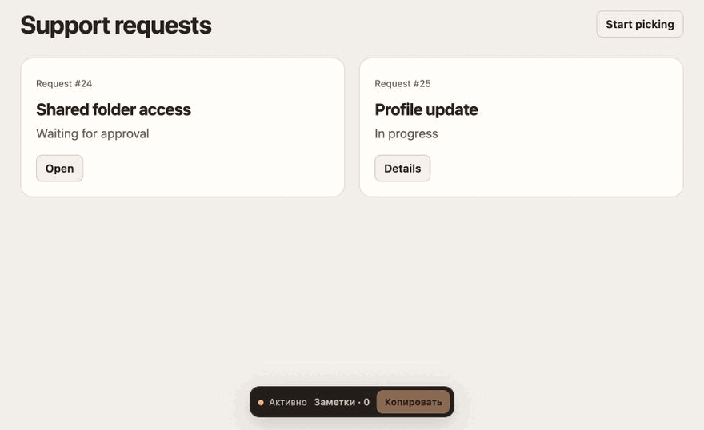

<p align="center">
  
</p>

<h1 align="center">Element Picker</h1>

<p align="center">Turn feedback on a live web page into actionable notes for your AI coding assistant.</p>

<p align="center"><strong>Chrome · Manifest V3</strong></p>

<p align="center">
  <strong>English</strong> · <a href="README.ru.md">Русский</a>
  <br>
  <a href="https://github.com/dmitriyg0r/element-picker/releases/latest">Download ZIP</a>
  · <a href="#install">Install</a>
  · <a href="#keyboard-shortcuts">Keyboard shortcuts</a>
</p>



## Why use it with an AI coding assistant?

When you spot a UI issue, show the assistant exactly where it is and what you want changed. Instead of describing where to find a button or a card, select it on the page and write the requested change next to it. Copy all your notes and paste them into Codex or another AI coding assistant. Each note includes the page path and a CSS selector or the coordinates of the selected area.

For example, click a button and write “Rename this button to **View request**.” Here is what the extension copies:

```text
Страница: /requests

1. Open
   Что исправить: Rename this button to “View request”.
   Блок: Request details
   Селектор: #open-request
   Тег: button
```

The current extension UI and export labels are in Russian. You can write notes in any language.

## How it works

1. Open the extension menu and click **Выбрать на странице** (Start picking), or use a shortcut.
2. Click an element or drag to select an area. A small note field opens next to the selection.
3. Write your note and press **Enter**. Click its numbered marker to edit it again.
4. Click **Копировать** (Copy) in the bottom toolbar and paste the notes into your assistant.

The **Заметки** (Notes) counter opens the list, where you can review or delete notes. If clipboard access fails, the extension selects the text for manual copying. Notes stay in the current page until you reload or close it.

## Install

1. Download the ZIP from the [latest release](https://github.com/dmitriyg0r/element-picker/releases/latest) and extract it. If you cloned the repository, use its root folder.
2. Open `chrome://extensions` and turn on **Developer mode**.
3. Click **Load unpacked** and choose the folder containing `manifest.json`.
4. Reload the page you want to annotate, then open the extension from the Chrome toolbar.

After updating the files, reload the extension at `chrome://extensions` and refresh the page you want to annotate.

## Keyboard shortcuts

| Action | Keys |
| --- | --- |
| Start or stop picking | `Alt + Shift + I` by default |
| Start or stop picking on a Mac | Quickly tap one `⌘` key twice, or press both `⌘` keys together |
| Save a note | `Enter` |
| Add a new line | `Shift + Enter` |
| Cancel editing or stop picking | `Esc` |

You can configure the main shortcut and the Mac gesture independently in the extension menu. Shortcuts follow the physical key. Chrome and the operating system may intercept some combinations.

## Data and permissions

The extension runs locally on HTTP and HTTPS pages. Collecting and copying notes requires no network requests. Settings are stored locally in Chrome. The extension skips input field values. Copied notes can include visible text from the selected element and its surrounding block. You choose where to paste them. See the [privacy policy](PRIVACY.md).

## Development

The extension uses plain JavaScript with no build step or third-party dependencies. `content.js` manages selection and notes, `capture.js` composes the copied text, `picker-styles.js` defines the on-page interface, and `shortcuts.js` handles keyboard input.

Run the tests with Node.js:

```bash
node --test tests/*.test.cjs
```
