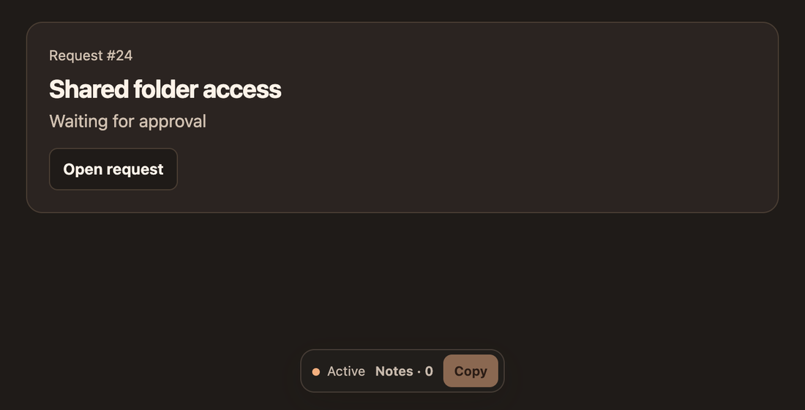

<p align="center">
  
</p>

<p align="center"><strong>Annotate web pages in Chrome and send precise UI feedback to your AI coding assistant.</strong></p>

<p align="center">
  <strong><a href="https://dmitriyg0r.github.io/element-picker/demo/">Try without installing</a></strong>
  · <a href="https://chromewebstore.google.com/detail/element-picker/bpanpgpfeahdpcnepkojffffdhlplbla">Install from Chrome Web Store</a>
  · <a href="#watch-the-demo">Demo</a> · <a href="#install">Installation</a>
  <br>
  <strong>English</strong> · <a href="README.ru.md">Русский</a>
</p>

## Watch the demo



## Quick start

1. Open the extension menu and click **Start picking**, or use a shortcut.
2. Click an element or drag to select an area. A small note field opens next to the selection.
3. Write your note and press **Enter**. Click its numbered marker to edit it again.
4. Click **Copy** in the bottom toolbar and paste the notes into your assistant.

The **Notes** counter opens the list, where you can review or delete notes. After a successful copy, the picker closes and clears the copied notes. If clipboard access fails, the extension keeps the notes and selects the text for manual copying. You can reopen the picker after pressing **Esc** to recover saved notes until you reload or close the page.

The copied notes include the page path and a CSS selector or the coordinates of the selected area. You can paste them into Codex or any other AI coding assistant.

<details>
<summary>See an example of the copied text</summary>

```text
Page: /requests

1. Open
   What to change: Rename this button to “View request”.
   Section: Request details
   Selector: #open-request
   Tag: button
```

</details>

The interface uses English or Russian based on your Chrome language. Starting with version 1.3.8, copied notes always use English labels. Your notes and text captured from the page keep their original language.

## Install

[Install from the Chrome Web Store](https://chromewebstore.google.com/detail/element-picker/bpanpgpfeahdpcnepkojffffdhlplbla).

### Install from a ZIP

1. Download the ZIP from the [latest release](https://github.com/dmitriyg0r/element-picker/releases/latest) and extract it. If you cloned the repository, use its root folder.
2. Open `chrome://extensions` and turn on **Developer mode**.
3. Click **Load unpacked** and choose the folder containing `manifest.json`.
4. Reload the page you want to annotate, then open the extension from the Chrome toolbar.

After updating the files, reload the extension at `chrome://extensions` and refresh the page you want to annotate.

## Keyboard shortcuts

| Action | Keys |
| --- | --- |
| Start or stop picking | `Alt + Shift + I` by default |
| Start or stop picking on a Mac | Quickly tap one `⌘` key twice, or press both `⌘` keys together |
| Save a note | `Enter` |
| Add a new line | `Shift + Enter` |
| Close the picker and keep saved notes | `Esc` |

You can configure the main shortcut and the Mac gesture independently in the extension menu. Shortcuts follow the physical key. Chrome and the operating system may intercept some combinations.

## Data and permissions

The extension runs locally on HTTP and HTTPS pages. Collecting and copying notes requires no network requests. Settings are stored locally in Chrome. The extension skips input field values. Copied notes can include visible text from the selected element and its surrounding block. You choose where to paste them. See the [privacy policy](PRIVACY.md).

## Development

The extension uses plain JavaScript with no build step or third-party dependencies. `content.js` manages selection and notes, `capture.js` composes the copied text, `picker-styles.js` defines the on-page interface, and `shortcuts.js` handles keyboard input.

Run the tests with Node.js:

```bash
node --test tests/*.test.cjs
```

## Feedback and support

[Report a bug or suggest an improvement](https://github.com/dmitriyg0r/element-picker/issues) · [Support development on DonationAlerts](https://www.donationalerts.com/r/dmitriygor)
