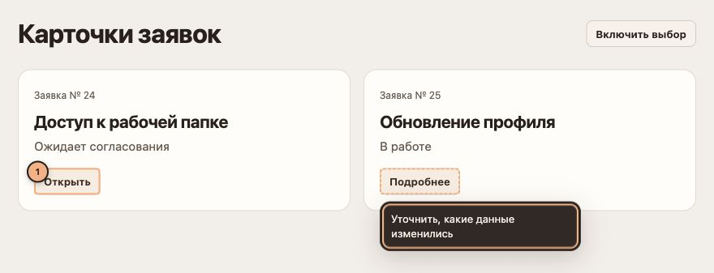

<p align="center">
  
</p>

<h1 align="center">Выбор элемента</h1>

<p align="center">Превращайте замечания к интерфейсу на открытой странице в конкретные задачи для ИИ-ассистента.</p>

<p align="center"><strong>Chrome · Manifest V3</strong></p>

<p align="center">
  <a href="README.md">English</a> · <strong>Русский</strong>
  <br>
  <a href="https://github.com/dmitriyg0r/element-picker/releases/latest">Скачать для Chrome</a>
  · <a href="#установка">Установка</a>
  · <a href="#горячие-клавиши">Горячие клавиши</a>
</p>



## Зачем это разработчикам, которые используют ИИ

Когда замечаете проблему в интерфейсе, покажите ИИ-ассистенту, где она и что нужно изменить. Выберите кнопку или карточку прямо на странице и напишите замечание рядом. Затем скопируйте все заметки и вставьте их в Codex или другой ИИ-ассистент для разработки. Вместе с замечанием копируются путь страницы и CSS-селектор элемента либо координаты выделенной области.

Например, кликните по кнопке и напишите «Переименовать в „Посмотреть заявку“». В буфер попадёт такой текст:

```text
Страница: /requests

1. Открыть
   Что исправить: Переименовать в «Посмотреть заявку».
   Блок: Карточка заявки
   Селектор: #open-request
   Тег: button
```

Интерфейс и подписи в скопированном тексте сейчас на русском. Заметки можно писать на любом языке.

## Как это работает

1. В меню расширения нажмите **Выбрать на странице** или воспользуйтесь горячей клавишей.
2. Кликните по элементу или выделите область мышью. Рядом откроется компактное поле заметки.
3. Напишите замечание и нажмите **Enter**. Чтобы вернуться к заметке, кликните по её номерной метке.
4. Нажмите **Копировать** на нижней панели и вставьте заметки в чат с ассистентом.

Счётчик **Заметки** открывает список, где можно просмотреть и удалить заметки. При сбое копирования расширение выделит текст для ручного копирования. Заметки хранятся до перезагрузки или закрытия страницы.

## Установка

1. Скачайте и распакуйте ZIP из [последнего релиза](https://github.com/dmitriyg0r/element-picker/releases/latest). Если клонировали репозиторий, используйте его корневую папку.
2. Откройте `chrome://extensions` и включите **Режим разработчика**.
3. Нажмите **Загрузить распакованное расширение** и выберите папку с файлом `manifest.json`.
4. Обновите страницу, на которой хотите оставить заметки, и откройте расширение на панели Chrome.

После обновления файлов перезагрузите расширение на странице `chrome://extensions` и обновите рабочую вкладку.

## Горячие клавиши

| Действие | Клавиши |
| --- | --- |
| Включить или завершить выбор | `Alt + Shift + I` по умолчанию |
| Включить или завершить выбор на Mac | Два быстрых нажатия одной `⌘` или одновременное нажатие левой и правой `⌘` |
| Сохранить заметку | `Enter` |
| Добавить строку | `Shift + Enter` |
| Отменить правку или завершить выбор | `Esc` |

Основное сочетание и жест с `⌘` настраиваются отдельно в меню расширения. Сочетания привязаны к физической клавише. Chrome и операционная система могут перехватывать часть сочетаний.

## Данные и доступ

Расширение работает локально на страницах HTTP и HTTPS. Сбор и копирование заметок не требуют сетевых запросов. Настройки хранятся локально в Chrome. Расширение пропускает значения полей ввода. В буфер может попасть видимый текст выбранного элемента и ближайшего блока. Куда вставлять заметки, решаете вы.

## Разработка

Расширение написано на JavaScript без сборки и сторонних зависимостей. `content.js` управляет выделением и заметками, `capture.js` формирует текст для копирования, `picker-styles.js` оформляет интерфейс на странице, а `shortcuts.js` обрабатывает горячие клавиши.

Для запуска тестов используйте Node.js:

```bash
node --test tests/*.test.cjs
```
