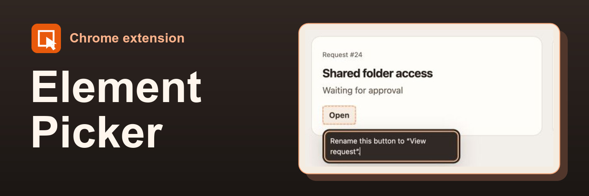

<p align="center">
  
</p>

<p align="center"><strong>Оставляйте заметки прямо на странице и передавайте ИИ-ассистенту точные правки по интерфейсу.</strong></p>

<p align="center">
  <strong><a href="https://dmitriyg0r.github.io/element-picker/demo/">Попробовать без установки</a></strong>
  · <a href="https://github.com/dmitriyg0r/element-picker/releases/latest">Скачать для Chrome</a>
  · <a href="#демонстрация">Демо</a> · <a href="#установка">Установка</a>
  <br>
  <a href="README.md">English</a> · <strong>Русский</strong>
</p>

## Демонстрация


## Быстрый старт

1. В меню расширения нажмите **Выбрать на странице** или воспользуйтесь горячей клавишей.
2. Кликните по элементу или выделите область мышью. Рядом откроется компактное поле заметки.
3. Напишите замечание и нажмите **Enter**. Чтобы вернуться к заметке, кликните по её номерной метке.
4. Нажмите **Копировать** на нижней панели и вставьте заметки в чат с ассистентом.

Счётчик **Заметки** открывает список, где можно просмотреть и удалить заметки. При сбое копирования расширение выделит текст для ручного копирования. Заметки хранятся до перезагрузки или закрытия страницы.

Вместе с заметками копируются путь страницы и CSS-селектор элемента либо координаты выделенной области. Вставить результат можно в Codex или другой ИИ-ассистент.

<details>
<summary>Посмотреть пример скопированного текста</summary>

```text
Страница: /requests

1. Открыть
   Что исправить: Переименовать в «Посмотреть заявку».
   Блок: Карточка заявки
   Селектор: #open-request
   Тег: button
```

</details>

Интерфейс и подписи в скопированном тексте переключаются между английским и русским по языку Chrome. Заметки можно писать на любом языке.

## Установка

1. Скачайте и распакуйте ZIP из [последнего релиза](https://github.com/dmitriyg0r/element-picker/releases/latest). Если клонировали репозиторий, используйте его корневую папку.
2. Откройте `chrome://extensions` и включите **Режим разработчика**.
3. Нажмите **Загрузить распакованное расширение** и выберите папку с файлом `manifest.json`.
4. Обновите страницу, на которой хотите оставить заметки, и откройте расширение на панели Chrome.

После обновления файлов перезагрузите расширение на странице `chrome://extensions` и обновите рабочую вкладку.

## Горячие клавиши

| Действие | Клавиши |
| --- | --- |
| Включить или завершить выбор | `Alt + Shift + I` по умолчанию |
| Включить или завершить выбор на Mac | Два быстрых нажатия одной `⌘` или одновременное нажатие левой и правой `⌘` |
| Сохранить заметку | `Enter` |
| Добавить строку | `Shift + Enter` |
| Отменить правку или завершить выбор | `Esc` |

Основное сочетание и жест с `⌘` настраиваются отдельно в меню расширения. Сочетания привязаны к физической клавише. Chrome и операционная система могут перехватывать часть сочетаний.

## Данные и доступ

Расширение работает локально на страницах HTTP и HTTPS. Сбор и копирование заметок не требуют сетевых запросов. Настройки хранятся локально в Chrome. Расширение пропускает значения полей ввода. В буфер может попасть видимый текст выбранного элемента и ближайшего блока. Куда вставлять заметки, решаете вы. См. [политику конфиденциальности](PRIVACY.md).

## Разработка

Расширение написано на JavaScript без сборки и сторонних зависимостей. `content.js` управляет выделением и заметками, `capture.js` формирует текст для копирования, `picker-styles.js` оформляет интерфейс на странице, а `shortcuts.js` обрабатывает горячие клавиши.

Для запуска тестов используйте Node.js:

```bash
node --test tests/*.test.cjs
```

## Обратная связь и поддержка

[Сообщить об ошибке или предложить улучшение](https://github.com/dmitriyg0r/element-picker/issues) · [Поддержать разработку на DonationAlerts](https://www.donationalerts.com/r/dmitriygor)
